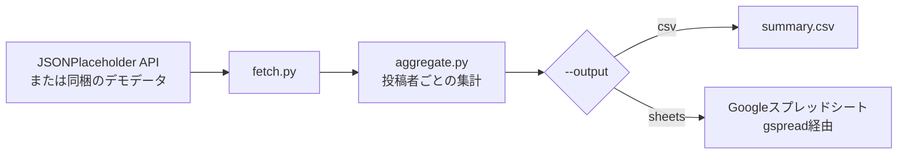

[English](README.md) | **日本語**

# Python Sheets Automation

公開APIからデータを取得して集計し、結果を **Googleスプレッドシート**（`gspread` 経由）か **CSVファイル** に書き出す、Python 3.11+ の小さなコマンドラインツールです。

> **これはデモ用のプロジェクトです。** APIからスプレッドシートへの自動化をどう組み立てるかを示すために書いた、オリジナルのサンプルコードです。クライアントの案件ではありません。Googleスプレッドシートへの書き込み部分はモックを使ったユニットテストで確認しており、CIで実際のスプレッドシートに対して実行はしていません。

作成: Tomohiro（日本・京都、UTC+9） - AI自動化デベロッパー | n8n・Python・API連携
Upwork: <https://www.upwork.com/freelancers/~0159af0451937c1a2a>

## できること

無料のデモ用API [JSONPlaceholder](https://jsonplaceholder.typicode.com) から投稿とユーザーを読み込み（オフライン時は同梱のダミーデータを使用）、投稿者ごとの投稿数と、タイトル・本文の平均単語数を計算して、投稿者ごとに1行の集計結果を書き出します。



```
src/sheets_automation/
  cli.py        引数の解析、処理の組み立て、終了コード
  fetch.py      APIクライアント（タイムアウト、エラー処理）とオフライン用デモデータの読み込み
  aggregate.py  集計ロジック（副作用なし）
  sinks.py      CSVとGoogleスプレッドシートへの書き込み
  demo_data/    --source demo で使うダミーのJSON
tests/          pytest（Googleスプレッドシートとネットワークはモック）
```

## インストール

```bash
git clone https://github.com/TOMO0904/python-sheets-automation.git
cd python-sheets-automation
python -m venv .venv && source .venv/bin/activate   # Windows: .venv\Scripts\activate
pip install -e ".[dev]"
```

## 使い方

```bash
# 1. オフラインで動作。アカウント不要
python -m sheets_automation --source demo --output csv --csv-path summary.csv

# 2. 公開APIから取得してCSVに出力
python -m sheets_automation --source api --output csv

# 3. 公開APIから取得してGoogleスプレッドシートに出力
export GOOGLE_APPLICATION_CREDENTIALS=/path/to/service-account-key.json
export SPREADSHEET_ID=your-spreadsheet-id
python -m sheets_automation --source api --output sheets --worksheet Summary
```

| オプション | 既定値 | 説明 |
|---|---|---|
| `--source` | `api` | `api` または `demo`（同梱のダミーデータ、オフライン） |
| `--output` | `csv` | `csv` または `sheets` |
| `--csv-path` | `summary.csv` | CSVの出力先 |
| `--spreadsheet-id` | 環境変数 `SPREADSHEET_ID` | スプレッドシートのURLに含まれるID |
| `--worksheet` | 環境変数 `WORKSHEET_NAME`、なければ `Summary` | なければ作成し、中身は置き換える |

成功すると終了コードは `0`、ネットワーク・設定・スプレッドシートのエラーでは `1` を返し、1行の `error:` メッセージを表示します。

### Googleスプレッドシートの準備

1. Google Cloudでサービスアカウントを作成し、**Google Sheets API** と **Google Drive API** を有効にします。
2. JSON形式の鍵をダウンロードし、**このリポジトリの外**に保存します。`GOOGLE_APPLICATION_CREDENTIALS` にそのパスを設定します（[`.env.example`](.env.example) を参照）。
3. スプレッドシートを、サービスアカウントのメールアドレスと「編集者」として共有します。

認証情報のファイルは、環境変数で指定したパスからのみ読み込みます。`.gitignore` で `.env` とよくある鍵ファイル名を除外しており、コミットしているのは `.env.example` だけです。

## 出力例（`--source demo`）

```
user_id,name,company,posts,avg_title_words,avg_body_words
1,Alex Sample,Example Studio,4,4.75,16.0
2,Bailey Demo,Sample Works,3,3.67,16.0
3,Casey Test,Demo Labs,2,4.0,16.0
9,(unknown),,1,4.0,16.0
4,Drew Idle,Placeholder Inc,0,0.0,0.0
```

ユーザー一覧にない投稿者の投稿は `(unknown)` にまとめ、投稿のないユーザーは0になります。

## 開発

```bash
ruff check .
pytest -q
```

GitHub Actionsで、pushとプルリクエストのたびにLint、テスト（Python 3.11、3.12、3.13）、オフラインでの動作確認を実行します。

## 制限事項

- データの取得元は固定のデモ用APIです。別のAPIに対応させるには `fetch.py` と `aggregate.py` を変更します。
- スプレッドシートへの出力は毎回ワークシートの中身を置き換えます（追記・統合モードはありません）。
- APIへのリトライやバックオフはなく、15秒のタイムアウトのみです。

## ライセンス

[MIT](LICENSE)
