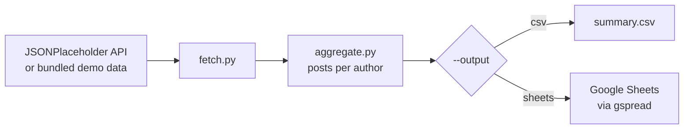

**English** | [日本語](README.ja.md)

# Python Sheets Automation

A small Python 3.11+ command-line tool that fetches data from a public API, aggregates it, and writes the result to **Google Sheets** (via `gspread`) or to a **CSV file**.

> **This is a demo project.** It is original sample code that shows how I structure API-to-spreadsheet automation. It is not client work. The Google Sheets path is covered by mocked unit tests; it has not been run against a real spreadsheet in CI.

Built by Tomohiro (Kyoto, Japan, UTC+9) - AI Automation Developer | n8n, Python & API Integration.
Upwork: <https://www.upwork.com/freelancers/~0159af0451937c1a2a>

## What it does

It reads posts and users from the free [JSONPlaceholder](https://jsonplaceholder.typicode.com) demo API (or from bundled dummy data when offline), counts posts per author, computes average title/body word counts, and writes one summary row per author.



```
src/sheets_automation/
  cli.py        argument parsing, wiring, exit codes
  fetch.py      API client (timeouts, error wrapping) + offline demo loader
  aggregate.py  pure aggregation logic
  sinks.py      CSV writer and Google Sheets writer
  demo_data/    dummy JSON used by --source demo
tests/          pytest (Google Sheets and network are mocked)
```

## Install

```bash
git clone https://github.com/TOMO0904/python-sheets-automation.git
cd python-sheets-automation
python -m venv .venv && source .venv/bin/activate   # Windows: .venv\Scripts\activate
pip install -e ".[dev]"
```

## Usage

```bash
# 1. Works offline, no accounts needed
python -m sheets_automation --source demo --output csv --csv-path summary.csv

# 2. Live public API, CSV output
python -m sheets_automation --source api --output csv

# 3. Live API, Google Sheets output
export GOOGLE_APPLICATION_CREDENTIALS=/path/to/service-account-key.json
export SPREADSHEET_ID=your-spreadsheet-id
python -m sheets_automation --source api --output sheets --worksheet Summary
```

| Option | Default | Notes |
|---|---|---|
| `--source` | `api` | `api` or `demo` (bundled dummy data, offline) |
| `--output` | `csv` | `csv` or `sheets` |
| `--csv-path` | `summary.csv` | CSV destination |
| `--spreadsheet-id` | env `SPREADSHEET_ID` | from the spreadsheet URL |
| `--worksheet` | env `WORKSHEET_NAME` or `Summary` | created if missing; contents are replaced |

Exit code is `0` on success and `1` with a one-line `error:` message on a network, configuration or Sheets failure.

### Google Sheets setup

1. Create a service account in Google Cloud and enable the **Google Sheets API** and **Google Drive API**.
2. Download its JSON key and store it **outside this repository**. Point `GOOGLE_APPLICATION_CREDENTIALS` at it (see [`.env.example`](.env.example)).
3. Share the spreadsheet with the service account's e-mail address (Editor).

The credentials file is only read from the path in the environment variable. `.gitignore` excludes `.env` and common key-file names, and only `.env.example` is committed.

## Example output (`--source demo`)

```
user_id,name,company,posts,avg_title_words,avg_body_words
1,Alex Sample,Example Studio,4,4.75,16.0
2,Bailey Demo,Sample Works,3,3.67,16.0
3,Casey Test,Demo Labs,2,4.0,16.0
9,(unknown),,1,4.0,16.0
4,Drew Idle,Placeholder Inc,0,0.0,0.0
```

Posts whose author is not in the user list are grouped as `(unknown)`; users without posts get zeros.

## Development

```bash
ruff check .
pytest -q
```

GitHub Actions runs lint, tests (Python 3.11, 3.12, 3.13) and an offline smoke run on every push and pull request.

## Limitations

- The data source is a fixed demo API; adapting it to another API means changing `fetch.py` and `aggregate.py`.
- Each Sheets run replaces the worksheet contents (no append/merge mode).
- No retry/backoff for the API beyond a 15-second timeout.

## License

[MIT](LICENSE)
